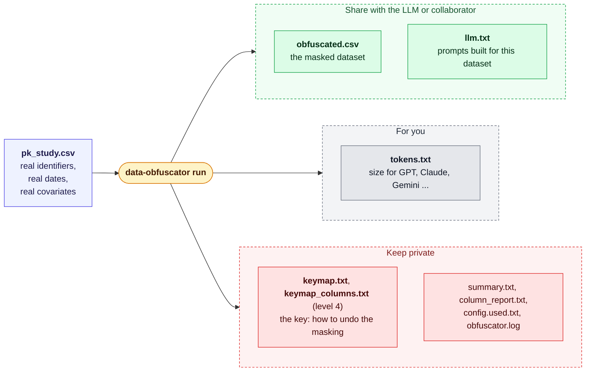

# data-obfuscator

**Mask a NONMEM-style pharmacometric dataset so it can be shown to an LLM or a collaborator, without
breaking the PK/PD structure that makes the data worth analysing.**

`data-obfuscator` is a single, offline command-line program written in Rust. It recodes identifiers, shifts
dates, rescales covariates and (optionally) renames columns, while leaving doses, observations, times and event
flags exactly as they were. Alongside the masked dataset it writes a ready-to-paste **prompt pack** tailored to
your data (`llm.txt`), a **token estimate** for the major LLM families (`tokens.txt`), and a private
**de-identification key** (`keymap.txt`, plus `keymap_columns.txt` at level 4) that only you keep, and a `reverse`
command that turns a masked dataset back into the original with that key.

Built for **Clinical Pharmacology, Pharmacometrics and Data Science** work.



---

## Contents

1. [The problem](#1-the-problem)
2. [What data-obfuscator does](#2-what-data-obfuscator-does)
3. [Why this is a good solution](#3-why-this-is-a-good-solution)
4. [See it work](#4-see-it-work)
5. [Install](#5-install)
6. [Quick start](#6-quick-start)
7. [Recommended workflow, start to finish](#7-recommended-workflow-start-to-finish)
8. [Commands](#8-commands) - [`run`](#run) · [outputs](#what-run-writes) · [`llm.txt`](#llmtxt-the-prompt-pack) · [`tokens`](#tokens) · [`reverse`](#reverse) · [`run2`](#run2-mask-several-datasets-let-an-llm-combine-them-then-restore)
9. [Masking levels](#9-masking-levels)
10. [How each kind of column is masked](#10-how-each-kind-of-column-is-masked)
11. [`keymap.txt` and `keymap_columns.txt`: the key to undo the masking](#11-keymaptxt-and-keymap_columnstxt-the-key-to-undo-the-masking)
12. [Options file](#12-options-file)
13. [Examples](#13-examples)
14. [Tokenization](#14-tokenization)
15. [Integrity guarantees](#15-integrity-guarantees)
16. [Privacy, limits and a pre-share checklist](#16-privacy-limits-and-a-pre-share-checklist)
17. [Version, banner and colours](#17-version-banner-and-colours)
18. [Troubleshooting and FAQ](#18-troubleshooting-and-faq)
19. [Project layout and development](#19-project-layout-and-development)
20. [Documentation map, author, license and citation](#20-documentation-map-author-license-and-citation)

---

## 1. The problem

Large language models are now genuinely useful in pharmacometric work: exploring a dataset, drafting a NONMEM
or mrgsolve model, reviewing a data set for errors before a run. To get that help, the model has to **see the
data**. And pharmacometric datasets are full of things that should not leave your organisation as they are:

- **Subject, study, site and investigator identifiers** (`USUBJID`, `STUDYID`, `SITEID`, `INVESTIGATOR`), which
  point straight back to a trial and the people in it.
- **Calendar dates** of dosing and sampling, which are personal data in many privacy regimes.
- **Free text** (comments, initials, e-mail addresses) and **category labels** (arm names such as
  `Active 50mg`, country, race).
- **Rare covariate combinations** and exact values that can single out a person.
- Sometimes even **column names** that reveal a compound, a protocol or a site.

Whether sharing such data with an external service is allowed depends on your sponsor agreements, the consent
given, privacy law and company policy. Check with your data-protection or compliance team; this tool is a
technical aid, not a compliance certificate.

The usual workaround is to scrub the file by hand in a spreadsheet or an ad-hoc script. That tends to go wrong in
predictable ways:

| What goes wrong | Consequence |
|---|---|
| The same subject gets two different new IDs, or two subjects get one | The analysis is silently wrong. |
| A time, dose or observation is edited, a row is re-sorted, an `EVID`/`MDV`/`CMT` flag is lost | The file no longer reflects the study, or NONMEM rejects it. |
| Dates are shifted row by row instead of by one offset | Intervals between visits, and the link between `DATE`+`CLOCK` and `TIME`, are destroyed. |
| The scrub cannot be repeated exactly, and the mapping is not kept | After the next data cut you cannot redo it, and you cannot translate the model's answer back to real subjects. |
| One column is missed (a site name in a text field, an e-mail in a comment) | A leak that nobody noticed. |
| The prompt is rewritten from scratch each time, with the study design re-explained | Slow, inconsistent, and the model guesses what the columns mean. |
| Nobody knows how many tokens the file costs until it is pasted | Truncated context, surprise bills. |
| A generic anonymiser is used | It does not know that `EVID=1` rows are doses, that `ADDL`/`II` encode repeated dosing, or that `DV` must not change. |

## 2. What data-obfuscator does

You give it a dataset (CSV, TSV, semicolon or whitespace-delimited, with or without a header). It writes a masked
copy and everything you need to use that copy safely:

- **Recodes identifiers and labels consistently.** Every distinct source value always becomes the same new
  value: subjects, studies, sites, investigators, arms, sex, race, country.
- **Shifts dates by one offset** for the whole file (a random decimal number of days, for example `23.6`), so all
  intervals survive.
- **Hides covariate values** (optional, level 3 and 4) by multiplying or dividing every number in a column by
  a hidden random factor between 1 and 20. At level 3 it is one factor per column, which keeps ratios, rank order
  and within-subject constancy. At level 4 that factor is only a base: every value gets its own factor, the base
  plus or minus 15 %, so even ratios and within-subject constancy are blurred.
- **Renames columns** (optional) when the column names themselves give something away.
- **Redacts or drops free text.**
- **Never touches the PK/PD core:** `TIME`, `TAD`, `DV`, `AMT`, `RATE`, `EVID`, `MDV`, `CMT`, `ADDL`, `II`, `SS`,
  `DVID`, `BLQ` and friends stay byte-for-byte as they were, and each subject's rows keep their time order.
- **Writes `llm.txt`:** three prompts (analyse the data, build a NONMEM control stream, perform quality-control
  checks) filled in from your masked file: counts, dose levels, compartments, special columns, covariates,
  which columns to `=DROP` in `$INPUT`.
- **Writes `tokens.txt`:** estimated token counts for GPT-4, GPT-4o, Claude, Gemini, Llama, Qwen and Mistral
  families, so you know whether the file fits before you paste it.
- **Writes `keymap.txt`:** the private key (renamed columns, scaling factors, date shift, original → masked
  values, column order) so you can translate results back. It is on by default. At level 4, where every value gets
  its own factor, it also writes **`keymap_columns.txt`** with the factor of every scaled value.
- **Reverses the masking** (`data-obfuscator reverse`): give it a masked dataset (rows and columns in any order, extra
  columns allowed) and the key, and it writes the dataset back with the real IDs, dates and numbers.
- **Explains itself:** a per-column report, a summary, the fully resolved options, a flushed log, and warnings in
  orange for anything you should look at before sharing.

**Aims**

- Let you use LLMs on real pharmacometric data **without handing over the identities in it**.
- Keep the masked file **structurally identical** to the original, so NONMEM, mrgsolve, R and QC scripts behave
  the same on it.
- Make masking **repeatable, auditable and reversible by you alone**.
- Make the **next step easy**: prompts that already describe the data, and a size estimate before you paste.
- Make mistakes **loud**: warnings for unshifted dates, unrecognised text columns, malformed rows, missing role
  columns and overwritten folders.

**Non-goals**

- It is **not formal anonymisation** and gives no legal guarantee; see [section 16](#16-privacy-limits-and-a-pre-share-checklist).
- It is **not encryption**. Anyone with `keymap.txt` (and `keymap_columns.txt`) and the masked file can reverse the masking.
- It does not read the study report, infer units, or understand your protocol. It does not upload anything: the
  program has no network code at all.
- It is a command-line tool, not a service or a GUI.

## 3. Why this is a good solution

| Design principle | What it means in practice |
|---|---|
| **Built for NONMEM structure** | The columns that carry the pharmacology (`TIME`, `DV`, `AMT`, `EVID`, `MDV`, `CMT`, `RATE`, `ADDL`, `II`, `SS`, `DVID`, `BLQ`, ...) are protected by default and never altered. Within-subject time order is preserved. |
| **Consistent by construction** | One dictionary per column: the same source value always maps to the same masked value. Several columns that describe the same thing (`STU`, `STUDYID`, `STUDY`) share one label when their values pair up, so a study never gets two codes. |
| **Intervals survive** | One date shift for the whole file; dates, clock times and `TIME` keep their relationships, so time-translation QC still works on the masked copy. |
| **Deterministic and verifiable** | Same input + same options + same seed give a **byte-identical** masked dataset. `summary.txt`, the log and the keymap header record its SHA-256, so two runs can be compared in seconds. |
| **Reversible, but only by you** | `keymap.txt` records every renamed column, every scaling factor, the date shift and every recoded value (and, at level 4, `keymap_columns.txt` the factor of every value), and `data-obfuscator reverse` applies it, even to a re-sorted or re-ordered dataset. Nothing in the masked file lets a reader undo it. |
| **Safe defaults** | The keymap is written by default. A run into a folder that already holds files stops unless you say `--overwrite`. Core PK/PD columns are protected. Hashed, sequential or padded IDs are one flag away. |
| **Loud about leaks** | Orange warnings for date text it could not shift, text columns it did not recognise and passed through, e-mail-like values left behind, rows with the wrong number of fields, role columns missing from the file, and renamed core columns. |
| **QC-friendly** | Malformed rows keep their shape in the masked copy, so a data-quality review of the masked file still sees the defect. The example set includes a QC dataset with 36 planted defects and an answer key. |
| **LLM-ready** | `llm.txt` is generated from the masked file itself, so the prompts match what you actually send. It tells the model which columns were rescaled or renamed, so it does not misread them. |
| **Transparent** | `column_report.txt` shows the role and action for every column; `config.used.txt` shows every resolved option; the log is flushed line by line and records panics. |
| **Offline, one binary** | A native executable with no runtime to install (no Python, R or Java) and no network code. Your data never leaves the machine you run it on. |
| **Configurable at any depth** | Pick a level for the quick answer, or set every option in a config file or on the terminal. Twenty-one ready-made example configs cover masking levels and purposes (QC, NONMEM, mrgsolve, external hand-off, audit). |
| **Tested** | Automated tests cover reproducibility at every level and ID style, multi-column roles, date and compact-date shifting, scaling, the keymap and overwrite behaviour, renaming, every example config, and the example QC datasets against their answer key. |

## 4. See it work

Input (`examples/sample.csv`, simulated data), a few columns:

```text
ID,USUBJID,STUDYID,SITEID,ARM,WT,AGE,SEX,RACE,DATE,INVESTIGATOR,COMMENT,COUNTRY,EMAIL,SUBJINIT
101,ABC-PK-2024-0142-0001,ABC-PK-2024,0142,Active 50mg,65.4,29,M,"ASIAN",2024-03-11,JSMITH,.,USA,n.patel.0142@harbor-site.org,RKO
```

Command:

```bash
data-obfuscator run --input examples/sample.csv --output ./masked --level 3 --date-columns DATE
```

Masked output (`obfuscated.csv`), same columns:

```text
ID,USUBJID,STUDYID,SITEID,ARM,WT,AGE,SEX,RACE,DATE,INVESTIGATOR,COMMENT,COUNTRY,EMAIL,SUBJINIT
1,SUBJ001,STU001,SITE001,ARM_A,7.4370771,6.9362792,0,CAT001,2024-05-01,USER001,.,C001,.,.
```

The doses and observations in the other columns of that row (`TIME`, `AMT`, `DV`, `EVID`, `MDV`, `CMT`, ...) are
identical to the source. The private `keymap.txt` records how to go back (`data-obfuscator reverse` does it for you):

```text
WT	divide	8.7937773185	180	none          <- 7.4370771 x 8.7937773185 = 65.4 kg
AGE	divide	4.1809159086	180	none
date_shift_days	51.9	DATE             <- 2024-05-01 minus 51 whole days = 2024-03-11
date_shift_whole_days	51	DATE
ARM	Active 50mg	ARM_A
COUNTRY	USA	C001
ID	101	1
```

On a terminal the run is colour-coded: green for completed steps, orange for warnings, red for errors, and a
banner at the top shows the program, version and run time.

## 5. Install

You need a recent stable **Rust toolchain** (get it from <https://rustup.rs>; Linux, macOS and Windows are all fine).

```bash
cd data-obfuscator               # the folder that contains Cargo.toml

cargo build --release            # binary: ./target/release/data-obfuscator  (.exe on Windows)
./target/release/data-obfuscator --version

# optional: put it on your PATH
cargo install --path .
data-obfuscator --help
```

On Windows PowerShell the binary is `.\target\release\data-obfuscator.exe`. In PowerShell, **quote lists** that
contain commas (`--keep "ID,TIME,DV"`), because an unquoted comma is PowerShell's array operator.

Run the test suite with `cargo test`.

Size and speed: the whole dataset is held in memory. On the development machine a 900,000-row, 142 MB file was
masked, with all output files written, in about 35 seconds.

## 6. Quick start

**1. The smallest possible run** (everything default: level 2, seed 42):

```bash
data-obfuscator run --input pk.csv --output ./masked
```

**2. Look at what it printed.** Orange lines are warnings to read before you share anything. Then open
`masked/column_report.txt` to confirm each column got the role you expected.

**3. Share `masked/obfuscated.csv`**, and paste the prompt you need from `masked/llm.txt`.
**Keep `masked/keymap.txt` private.**

**4. A more deliberate run:**

```bash
data-obfuscator run -i pk.csv -o ./masked_l3 --level 3 --seed 20261008 \
  --keep ID,USUBJID,STUDYID,ARM,TIME,TAD,AMT,RATE,DV,EVID,MDV,CMT,WT,AGE,SEX,DATE \
  --date-columns DATE
```

**5. Or put the options in a file** (see [section 12](#12-options-file) and [`CONFIGS.md`](CONFIGS.md)):

```bash
data-obfuscator run --config study_options.txt
```

**6. Running again into the same folder** stops with an error, so you never overwrite results by accident. Choose a
new folder, or add `--overwrite`.

## 7. Recommended workflow, start to finish

1. **Mask.** Run `data-obfuscator run` with the level that suits the audience ([section 9](#9-masking-levels)).
   Use level 2 when covariate values must stay real (QC, NCA, exploration); use level 3 or 4 when they must not
   be recognisable.
2. **Read the warnings and `column_report.txt`.** Fix what they point out: name an unusual identifier column
   (`--sensitive`, a role option), drop a column you do not need, or convert an unreadable date format.
3. **Check the output.** Open `obfuscated.csv` and confirm that nothing identifying is left, in values *or* in
   column names (`--rename-columns` if names give something away).
4. **Add units.** Datasets do not record units; the prompts ask the model to use the ones you state. Add them to the
   prompt before sending.
5. **Send** `obfuscated.csv` plus one prompt from `llm.txt`. `tokens.txt` tells you whether it fits the model's context.
6. **Translate the answer back** if you need to: `data-obfuscator reverse --input <masked or model output> --keymap
   keymap.txt` (see [`reverse`](#reverse)). It reverses the scaling, subtracts the date shift and looks up the original
   IDs, even if the rows were re-sorted or the columns re-ordered. The model only ever saw masked values.
7. **Re-run after a data cut** with the same options and seed to get the same mapping again; compare the SHA-256 in
   `summary.txt` when you need to prove two runs are identical.

## 8. Commands

### `run`

```bash
data-obfuscator run --input pk.csv --output ./masked --level 2
data-obfuscator run --config study_options.txt
```

Options at a glance (every option, its aliases and defaults are in [`CONFIGS.md`](CONFIGS.md#5-option-reference-every-option);
`data-obfuscator run --help` lists them too). A command-line flag always overrides the same setting in a config file.

| Group | Option | What it does |
|---|---|---|
| **Input / output** | `-i, --input FILE` | The dataset (CSV, TSV, semicolon, whitespace). |
| | `-o, --output DIR` | Folder for all results; created if missing. Must be empty or new unless `--overwrite`. |
| | `-c, --config FILE` | Read options from a file. |
| | `--output-name NAME` | Name of the masked dataset (default `obfuscated.csv` / `.tsv` / `.dat`). |
| | `--overwrite` | Allow writing into a folder that already contains files. |
| **How much to mask** | `-l, --level 1-4` | `1` light, `2` clinical (default), `3` covariate, `4` maximum. |
| | `--seed N` | Random seed (default 42). `seed = auto` in a config file draws a new one each run. |
| | `--id-style` | `sequential` (default), `padded` or `hashed`. |
| **Columns** | `--keep COLS` / `--drop COLS` | Reduce the output to the columns you need (default: all). |
| | `--protect COLS` | Columns that must never be altered (replaces the built-in list). |
| | `--id-column`, `--subject-column`, `--study-column`, `--site-column`, `--treatment-column`, `--user-column` | Tell it which column is which. Each takes **one or several** names. |
| | `--sensitive COLS` | Extra identifier columns to recode like `USUBJID`. |
| | `--freetext-columns COLS`, `--drop-freetext` | Free-text columns to redact (or drop). |
| | `--date-columns COLS` | Date columns to shift. |
| | `--scale-columns COLS`, `--scale-range MIN-MAX` | Extra columns to scale at level 3+, and the range of the factor (default `1-20`). |
| | `--rename-columns COLS`, `--rename-except COLS`, `--rename-prefix P` | Rename columns (see [10.6](#106-renaming-columns)). |
| **Dates** | `--date-shift-days MIN-MAX\|DAYS` | Window for the random shift (default `1-100`, decimals allowed), or one fixed number such as `23.6`. |
| **Reading the file** | `--delimiter`, `--no-header`, `--columns`, `--comment-chars` | Unusual files: tab, space, semicolon, no header row, comment lines. |
| **Safety / diagnostics** | `--write-keymap [BOOL]` | Write `keymap.txt` (**on by default**; `false` or `0` switches it off). |
| | `-v, --verbose` | Extra DEBUG lines. |
| **Global** | `-V, --version`, `--no-color`, `-h, --help` | Banner, plain output, help. |

#### What `run` writes

Into `--output`:

| File | Purpose | Safe to share? |
|---|---|---|
| `obfuscated.csv` (or `.tsv` / `.dat`, or `--output-name`) | The masked dataset, with the columns you asked for | **Yes** |
| `llm.txt` | Prompt pack tailored to this dataset (analyse, NONMEM control stream, QC) | **Yes** (paste the prompt you need) |
| `tokens.txt` | Token estimates for the input, the output and the other files (**not** the log), for GPT, Claude, Gemini, Llama, Qwen and Mistral families | Harmless |
| `column_report.txt` | Role and action per column; lists the **original** column names and any renames | Only if column names are not sensitive; **no** if you renamed columns |
| `summary.txt` | What was done: counts, level, seed, date shift, scaled and renamed columns, dataset SHA-256 | **No**: it reveals the seed and the date shift |
| `config.used.txt` | Fully resolved options | **No** (seed, paths) |
| `obfuscator.log` | Line-flushed trace, including panics | **No** (paths, command line) |
| `keymap.txt` | Descriptive header, renamed columns, scaling factors, date shift, original → masked values, column order | **Never** |
| `keymap_columns.txt` | **Level 4 only.** The factor every scaled value was multiplied or divided by, with the row key (ID, TIME, ...) | **Never** |

Rule of thumb: **share only `obfuscated.*` and `llm.txt`.**

#### `llm.txt`: the prompt pack

Three single-paragraph prompts you paste into an LLM together with `obfuscated.csv`, preceded by a short "how to
use" note and a facts table. Everything is computed from the masked file itself, so the prompts describe exactly
what you are sending:

1. **Analyse the data.** Study design and completeness, dose levels, sampling, exposure and covariate
   exploration, with the structure the model must respect (EVID, MDV, CMT, RATE, ADDL/II, SS, BLQ, DVID endpoints).
2. **Create a NONMEM control stream.** `$INPUT` already marks text columns `=DROP`, with compartments, dosing
   records and censoring handled according to what is in your file.
3. **Perform quality-control checks.** The checks a data programmer would make: will NONMEM accept the file; are
   dosing and observation records coded correctly; does the time column translate the dates and clock times;
   does `AMT` match the planned `DOSE`; nominal vs actual time; endpoint coding; and more.

The facts table lists subjects, records, observations, dose levels, compartments, special columns, treatment
groups, covariates and the approximate token size. If covariates were rescaled, the prompts say so and tell the
model not to judge those columns against real-world ranges; columns that were renamed to generic labels are listed
as unlabelled so that the model asks instead of guessing.

### `tokens`

```bash
data-obfuscator tokens --input pk.csv --output ./masked
```

Estimates the tokens of `--input` and of every file already in `--output` except the log, and writes
`tokens.txt`. See [section 14](#14-tokenization).

### `reverse`

Undoes the masking of a dataset with the key that `run` wrote.

```bash
# the key files are found next to the masked dataset
data-obfuscator reverse --input masked/obfuscated.csv --output ./restored

# a dataset that came back from a collaborator or a model, with the key elsewhere
data-obfuscator reverse -i returned_table.csv --keymap keys/keymap.txt --keymap-columns keys/keymap_columns.txt
```

(A `keymap2.txt` from [`run2`](#run2-mask-several-datasets-let-an-llm-combine-them-then-restore) is recognised automatically; the options `--map` and `--date-columns` are for that key.)

It writes `restored.csv` (or `.tsv` / `.dat`, or `--output-name`), `reverse_report.txt` (what was undone, counts,
warnings, the restored SHA-256) and `reverse.log` into `--output` (default `./restored`). The folder must be empty or
new unless you add `--overwrite`.

| What it undoes | How |
|---|---|
| **Renamed columns** | Back to their original names (section 1 of `keymap.txt`). |
| **Numeric scaling** | Level 3: divided or multiplied by the column's factor, **exactly**. Level 4: by the factor of **each value**, from `keymap_columns.txt`, also **exactly**. |
| **Dates** | The date shift is subtracted (date-times by the exact decimal, date-only values by the whole days). |
| **IDs and labels** | Every masked ID, subject, study, site, arm, sex, race and country value is looked up in section 4 of `keymap.txt`. |
| **Column and row order** | Columns go back to the order the masked dataset was written in; at level 4 rows go back to the **source row order** (`keymap_columns.txt` records it). |

**The input may be re-sorted, have its columns in any order and carry extra columns** (for example a NONMEM table
with `PRED` and `IPRED` added): columns are found by name, and the factors of level 4 are found by the row key (the
masked `ID`, `STU`/`STDY`, `TIME`, `DVID`, `EVID`, `CMT` ...) together with the masked numbers, never by position. Extra columns
are kept and put at the end. The report says how many rows were matched.

What it cannot bring back, and says so: **redacted free text** (cells are `.`), **columns that were dropped**
or not kept (`keymap.txt` section 5 lists them), the **original spelling** of dates written as `DD-MMM-YYYY` or
`YYYY/MM/DD` (they come back as `YYYY-MM-DD`), and the exact **text form** of numbers (`70.50` comes back as `70.5`).

| Option | What it does |
|---|---|
| `-i, --input FILE` | The masked dataset (required). |
| `-k, --keymap FILE` | `keymap.txt` (default: next to the input). |
| `--keymap-columns FILE` | `keymap_columns.txt` (default: next to `keymap.txt`, when it exists). It must belong to the same run as `keymap.txt` (the masked-file SHA-256 is compared); a mismatch is an error. |
| `-o, --output DIR`, `--output-name NAME`, `--overwrite` | Where and under which name to write, and whether a non-empty folder may be reused. |
| `--only STEPS` / `--skip STEPS` | Undo only, or all but, these parts: `rename`, `scaling`, `dates`, `recoding` (comma-separated). For example `--only recoding` turns the IDs back but leaves the numbers and dates masked. |
| `--strict` | Stop with an error instead of approximating, skipping a column that is missing, or leaving values the key does not know unchanged. |
| `--keep-order` | Keep the input's column and row order instead of restoring the original order. |
| `--delimiter`, `--no-header`, `--columns`, `--comment-chars` | Read an unusual input file (same meaning as for `run`). |

If a level 4 key is used **without** `keymap_columns.txt`, the scaled columns can only be restored approximately (the
base factor is used, so each value is within about 15 % of the original) and the run warns; `--strict` refuses. The
restored dataset holds real, identifying data again: **do not share it**, and do not share `reverse_report.txt`.

### `run2`: mask several datasets, let an LLM combine them, then restore

A common job: the study data are CDISC ADaM datasets (`ADSL`, `ADEX`, `ADPC`, `ADLB`, ...) and an LLM is to combine
them into one NONMEM-style master dataset. `run` masks one dataset at a time, with separate codes for each, so the
LLM could not join them. `run2` masks **all the datasets together**:

```bash
data-obfuscator run2 --input adsl.csv --input adex.csv --input adpc.csv --input adlb.csv --level 3 --output ./masked2
data-obfuscator run2 --input ./adam_folder --output ./masked2          # every .csv .tsv .txt .dat .tab file in it
data-obfuscator run2 --config examples/adam/run2-config.txt            # `input = ...` once per dataset
```

| Shared by all datasets | Why it matters |
|---|---|
| **One code table per identifier kind** (subject, study, site, treatment, user, sex, race, country) | The same real `USUBJID` has the same code in every file, so the LLM can join on it. |
| **One date shift**, a whole number of days | Date-only (`ADT`) and date-time (`ADTM`, `EXSTDTC`) columns move by exactly the same amount, so every interval between datasets stays exact. |
| **One factor per scaled column name** (level 3) | `AVAL` has the same factor wherever it occurs, so values from different datasets stay comparable. |

ADaM names are recognised on top of `run`'s own detection: columns ending in `DT`, `DTM`, `DTC` (`ADT`, `ADTM`,
`TRTSDT`, `RFSTDTC`, ...) are dates, `TRT...` columns are treatments, `INVID`/`INVNAM` are users
(`--adam-hints false` switches that off; `--date-columns`, `--subject-column` ... work as in `run`).

**What it writes into `--output`**

| File | What | Share? |
|---|---|---|
| `adsl_masked.csv`, `adpc_masked.csv`, ... | One masked file per input, same columns and row order (`drop` columns removed, free text `.`) | **Yes** |
| `llm2.txt` | Ready-to-paste prompts: build the master dataset (with rules that keep the result reversible), check it against the sources; lists every dataset and which columns are masked | **Yes** |
| `keymap2.txt` | The key: files, the code tables, the date shift, the scaling factors, what cannot be restored | **Never** |
| `summary2.txt`, `config.used.txt`, `run2.log` | Record of the run (shows the seed and the date shift) | **Never** |

`run2` differs from `run` on purpose: **levels 1-3 only** (level 4 re-sorts rows and varies every value, which could
not be traced through a merged dataset), no `keep` (the datasets have different columns; use `drop`) and no column
renaming (the LLM has to see the ADaM names). `USUBJID` and `SUBJID` are different values, so they get different codes.

**Getting the real values back.** Save the master dataset the LLM returns and use the same `reverse` command; it
recognises `keymap2.txt` by itself:

```bash
data-obfuscator reverse --input master.csv --keymap keymap2.txt --output ./restored
data-obfuscator reverse -i master.csv -k keymap2.txt --map ID=USUBJID --map WT=WEIGHTBL --map DV=AVAL
data-obfuscator reverse -i master.csv -k keymap2.txt --map ID=USUBJID --map DV=PCSTRESN:DVID=1 --map DV=LBSTRESN:DVID=2
```

The master dataset has new rows in any order, so nothing is matched by row. Every **column** is restored on its own:

| Column of the master dataset | How it is restored |
|---|---|
| Kept its ADaM name (`USUBJID`, `STUDYID`, `ARM`, `SEX`, ...) | Codes looked up in the shared table. A column with another name is also recognised when at least 80 % of its values are codes of one table. |
| A date column (`ADT`, `DATE`, ...) | The shift is taken off (a text date or date-time in an unnamed column is found by its look). `--date-columns` names extra ones. |
| A scaled column that kept its name | The exact original number (the shortest decimal that the masking turns into the masked text). |
| **Renamed or merged by the LLM** (`DV` from `AVAL`, `WT` from `WEIGHTBL`, `ID` from the digits of `USUBJID`) | Tell `reverse` with `--map COMBINED=SOURCE`. If one column takes values from differently scaled sources, add a condition: `--map DV=PCSTRESN:DVID=1`. `ID=USUBJID` also accepts a number built from the digits of the code (`SUBJ007` -> `7`) and writes the real `USUBJID`. Without the rule `reverse` warns when a column looks like that number. |
| Anything the LLM derived (a log of `DV`, a unit conversion, a new category) | Cannot be recognised: left as it is. |

Values that are not codes of the key (an identifier the LLM invented or changed) are left unchanged and reported;
`--strict` stops instead. `--only` / `--skip` choose `recoding`, `dates`, `scaling`. `llm2.txt` already tells the
LLM to keep the ADaM column names, to derive `ID` from the digits of the masked `USUBJID`, not to transform scaled
columns in place, and to record the source of every `DV` value. `reverse_report.txt` lists, column by column, what was
done and what could not be restored (redacted free text, dropped columns, a different spelling of numbers).

## 9. Masking levels

Each level includes everything from the levels below it.

| Level | Name | What changes |
|---|---|---|
| 1 | light | Recodes **ID, USUBJID, STUDYID, SITEID and user/investigator columns**. Nothing else: dates are *not* shifted and free text is *not* removed (you get a warning if a date column is kept). |
| 2 | clinical (default) | Also recodes **ARM, SEX, RACE, COUNTRY**, shifts **dates** by one offset, and redacts **free text** (cells become `.`). |
| 3 | covariate | Also multiplies or divides **every number in each covariate column** (WT, AGE, HT, BMI, lab values, ...) by one hidden random factor between 1 and 20 (the same factor for the whole column). |
| 4 | maximum | Scales covariates with a base factor per column **and a different random factor for every value** (base +/- 15 %), **drops** free-text columns, and orders rows by masked ID. |

At every level `TIME`, `TAD`, `DV`, `AMT`, `RATE`, `EVID`, `MDV`, `CMT`, `ADDL`, `II`, `SS` and the other
protected columns stay exactly as in the source. Missing values (`.` or empty) are never recoded.

**Which level?** Level 2 is the right default for everyday sharing and keeps covariates real, which is what QC, NCA
and exploration need. Choose level 3 when exact covariate values could identify someone and the analysis only
needs ratios, rank order and shape. Choose level 4 for the strongest built-in masking (values are also blurred by
about 15 % from row to row, so a subject's covariate is no longer constant), for example an external
hand-off. Remember that scaled covariates are **not physiological**; see [10.4](#104-numeric-scaling-level-3-and-4).

## 10. How each kind of column is masked

### 10.1 Column roles and auto-detection

Column names are matched case-insensitively. Anything not recognised is **passed through unchanged**, so name
unusual identifier columns yourself, or drop them. The run warns about unrecognised columns that contain text,
because that is where a study title or site name would slip out.

| Role | Recognised names (examples) | What happens |
|---|---|---|
| id | `ID`, `NMID` | recoded (level 1+) |
| subject | `USUBJID`, `SUBJID`, `SUBJECT`, `PATIENT`, `PTID` | recoded (level 1+) |
| study | `STUDY`, `STU`, `STUDYID`, `PROTO`, `PROTOCOL`, `TRIAL` | recoded (level 1+) |
| site | `SITE`, `SITEID`, `CENTER`, `CENTRE` | recoded (level 1+) |
| user | `INVESTIGATOR`, `USERID`, `CRA`, `OPERATOR`, `ANALYST` | recoded (level 1+) |
| treatment | `ARM`, `TRT`, `TREATMENT`, `COHORT`, `ARMCD`, `DOSEGRP` | recoded (level 2+) |
| sex / race / country | `SEX`, `GENDER` / `RACE`, `ETHNIC` / `COUNTRY` | `0`/`1` / `CAT001`... / `C001`... (level 2+) |
| date | `DATE`, `DATETIME`, names ending `DTC` or `_DT`, `DOB`, `BRTHDAT`, `VISITDT` | shifted (level 2+) |
| free text | `COMMENT`, `NOTE`, `EMAIL`, `PHONE`, `NAME`, `INITIALS`, `SUBJINIT`, `ADDRESS` | redacted (level 2+), dropped (level 4) |
| covariate | `WT`, `AGE`, `HT`, `BMI`, `CRCL`, `EGFR`, `SCR`, `ALT`, `AST`, `BILI`, `ALB`, `BSA` | scaled (level 3+) |
| protected | `TIME`, `TAD`, `DV`, `LNDV`, `AMT`, `RATE`, `EVID`, `MDV`, `CMT`, `ADDL`, `II`, `SS`, `DVID`, `CENS`, `LIMIT`, `BLQ`, `OCC`, `PC`, `PCYC` | never altered |

The complete name lists are in [`CONFIGS.md`](CONFIGS.md#62-column-roles-and-auto-detection). The role options
override or extend this table, and `column_report.txt` shows the role and action chosen for every column.

### 10.2 Identifiers and labels (ID styles)

Every distinct source value gets one masked value, in order of first appearance, and the same value always gets the
same result.

| `--id-style` | Subject ID (`ID` column) | Other recoded columns |
|---|---|---|
| `sequential` (default) | `1`, `2`, `3`, ... | prefixed and padded: `SUBJ001`, `STU001`, `SITE001`, `USER001`, `ARM_A`, `CAT001`, `C001` |
| `padded` | `0001`, `0002`, ... | same |
| `hashed` | 5-digit number from a seeded SHA-256 | prefix plus 8 hex characters, e.g. `SITE3F9A1C07` |

`hashed` IDs are not checked for collisions (they come from a 5-digit space); use `sequential` or `padded` for large
datasets.

**Several columns per role.** A file often describes one thing in several columns (`STU`, `STUDYID` and `STUDY` are
all the study). Every role option takes one or several names, and all of them are masked:

```text
study_column   = STU, STUDYID, STUDY      # comma, semicolon or pipe; or repeat the key
subject_column = USUBJID, SUBJID
```

```bash
data-obfuscator run -i pooled.csv -o ./masked --study-column STU,STUDYID,STUDY --subject-column USUBJID,SUBJID
```

Columns of one role whose values pair up one-to-one row by row **share one masked label**, so a study never gets
two codes. Columns that do not pair up get their own labels, so a coarse column is never merged into a finer one by
accident. A listed name that is not in the file is reported and ignored.

### 10.3 Dates

- One random shift for the **whole dataset**: by default a **decimal number of days between 1 and 100**, for example
  `23.6`. Intervals between dates are preserved exactly.
- Fix it yourself with `--date-shift-days 23.6` (a negative number shifts backwards), or give a window with
  `--date-shift-days 30-365`. For sharing outside your organisation a wider window such as `365-1460` hides the real
  calendar period better.
- Values that carry a **time of day** (`2024-03-25 08:00`, `202403250800`) move by the exact fraction;
  `2024-03-25 08:00` + 23.6 days is `2024-04-17 22:24`. **Date-only** values (`2024-03-25`, `20240325`,
  `25-MAR-2024`) move by the whole days, so their intervals stay exact.
- Recognised formats: `YYYY-MM-DD`, `YYYY/MM/DD` (optionally followed by a time), `DD-MMM-YYYY`, and compact
  **`YYYYMMDD`** with an optional time. Compact dates keep their compact form. Numeric day counts get the exact
  decimal added.
- A date the program cannot read (for example `DD/MM/YYYY`, whose day/month order it will not guess) is left
  **unchanged and the run warns**, because it still shows the real date.
- The exact shift is written to `keymap.txt`, `summary.txt` and `config.used.txt`.

### 10.4 Numeric scaling (level 3 and 4)

For each covariate column (and each column in `--scale-columns`) the program draws **one** random factor between
`--scale-range` (default `1-20`) and one random operation, **multiply or divide**.

- **Level 3:** every valid number in the column is multiplied or divided by that same factor. Ratios inside a
  column, rank order and within-subject constancy are kept; a covariate that is constant for a subject stays
  constant.
- **Level 4:** that factor is only the column's **base**. Every valid number gets its **own** random factor, the base
  plus or minus 15 % (uniform). With a base of 5, a factor lies between 4.25 and 5.75, so `1, 3, 5, 6, 7` could
  become `4.5, 15.3, 26.1, 28.4, 37` (illustration; real draws differ). Rank order is mostly kept but no longer
  guaranteed, ratios are only approximate, and a covariate that is constant for a subject now varies by up to
  about 15 % in either direction from row to row. The factor of every value is written to `keymap_columns.txt`, so
  `reverse` restores level 4 exactly; with only `keymap.txt` it can restore to within about 15 %.
- Text, blank cells and `.` are untouched; `0` stays `0`. Results carry up to 8 significant digits.
- The operation and the (base) factor of every scaled column are written to `keymap.txt`, with a column that says
  whether the factor varies per value (`none` at level 3, `+/-15%` at level 4). The factor is written with full
  precision so that `reverse` can undo the scaling exactly.
- At level 4 the factor of **every value** is written to **`keymap_columns.txt`** (see [section 11](#11-keymaptxt-and-keymap_columnstxt-the-key-to-undo-the-masking)),
  so `reverse` can restore the numbers exactly; without that file level 4 can only be undone to within about 15 %.
- A factor near 1 hides little. For stronger masking raise the lower bound: `--scale-range 5-20`.
- **Scaled values are not physiological.** A 70 kg subject may become 8 kg. `llm.txt` tells the model, so it does
  not flag them as implausible and centres allometric scaling on the median instead of 70 kg. When you need real
  covariate values (QC plausibility checks, NCA), use level 2.

### 10.5 Free text, `keep`, `drop` and `protect`

- **Free text** (`COMMENT`, `EMAIL`, `SUBJINIT`, ... or `--freetext-columns`) is redacted from level 2 (cells
  become `.`) and dropped at level 4 or with `--drop-freetext`.
- **`--keep`** lists the output columns and their order; omit it to keep everything. A 100-column file can be
  reduced to the 30 you model. **`--drop`** removes columns and wins over `keep`. Dropping a core PK/PD column
  (`TIME`, `DV`, `AMT`, `EVID`) is allowed but warns.
- **`--protect`** replaces the built-in protected list with the explicit list you give.
- **Malformed rows** (wrong number of fields) are not silently repaired: they keep their shape when all columns are
  kept, and the run warns, so a QC pass on the masked file still sees them.

### 10.6 Renaming columns

Off by default. Use it when the column **names** give something away (`SITE_NAME_BOSTON`, `PROTO_ABC_FLAG`), not
only the values.

```bash
# rename these columns (automatic names such as COL03, or WT=BODYSIZE to choose the name)
data-obfuscator run -i pk.csv -o ./masked --rename-columns SITE_NAME,PROTNAME,WT=BODYSIZE

# or rename everything EXCEPT these (shorter when most columns are renamed)
data-obfuscator run -i pk.csv -o ./masked --rename-except ID,TIME,DV,AMT,EVID,MDV,CMT
```

- Automatic names are the prefix (`--rename-prefix`, default `COL`) plus the column's position in the masked file:
  the 7th column becomes `COL07`. `OLD=NEW` uses your name. The two modes cannot be combined.
- Only **names** change; the cells are masked as usual. Other column options keep using the **original** names.
- Every rename is recorded in `keymap.txt` (section 1). `llm.txt` uses the new names and treats automatically
  named columns as unlabelled.
- Warnings: names that are not in the masked dataset; renaming core NONMEM columns such as `TIME` or `DV`
  (list them under `--rename-except` to keep them); a switched-off keymap.
- `column_report.txt`, `summary.txt`, `config.used.txt`, `keymap.txt` and the log still show the original names.

## 11. `keymap.txt` and `keymap_columns.txt`: the key to undo the masking

Written by default (`--write-keymap false` or `0` switches it off). It opens with a descriptive header (a
"confidential" warning, the program version, the source and masked file names, the masked file's SHA-256, level, seed,
ID style, whether a `keymap_columns.txt` exists, a table of contents and how to read it) followed by five numbered
sections. Lines starting with `#` are
comments; every other line is TAB-separated. The header holds no timestamp, so the key is identical on every re-run
with the same input, options and seed.

| Section | Format | How to undo it |
|---|---|---|
| 1. COLUMN RENAMING | `renamed_column  original  new` | Rename the column back. |
| 2. NUMERIC SCALING | `column  multiply\|divide  factor  values changed  variation` | Divide by the factor if it was multiplied; multiply by it if it was divided. Listed under the **original** column name. Exact when the variation is `none` (level 3); when it is `+/-15%` (level 4) the factor is only the base and the factor of each value is in `keymap_columns.txt`. |
| 3. DATE SHIFT | `date_shift_days  23.6  DATE` and `date_shift_whole_days  23  DATE` | Subtract the days from date-times; subtract the whole days from date-only values. |
| 4. IDENTIFIER AND LABEL RECODING | `column  original  masked` | Look the masked value up. |
| 5. COLUMN ORDER, AND WHAT CANNOT BE RESTORED | `column_order  position  original name  masked name` and `not_restorable  column  why` | The order the columns were written in, and the columns whose values are stored nowhere (redacted free text, dropped columns). |

**Never send this file to an LLM, a vendor or a collaborator.** With it, the masking can be undone. The
`reverse` command ([section 8](#reverse)) reads it for you.

### `keymap_columns.txt` (level 4 only)

At level 4 every number in a scaled column is multiplied or divided by **its own** factor (the column's base factor
plus or minus 15 %), so the base factor in `keymap.txt` cannot undo it exactly. `run` therefore also writes
`keymap_columns.txt` whenever level 4 scales at least one column and the keymap is on. It is private, like
`keymap.txt`. It has a descriptive header, a few `@` layout lines and then **one TAB-separated line per data row of the
source**:

```text
@key_columns	ID	TIME	EVID	CMT              the identifier columns of the masked dataset
@value_columns	WT	AGE                       the columns whose values were scaled
@operations	divide	divide
@base_factors	8.7937773185	4.1809159086
@variation	+/-15%
17	1	0.5	0	2	7.5412907	9.2101886	6.7230119	4.5418877
^source row  ^ID ^TIME ^EVID ^CMT  ^masked WT, its factor   ^masked AGE, its factor
```

- **The row key** is the masked `ID` (and `SUBJID`-type columns), the study columns (`STU`, `STDY`, `STUDY`,
  `STUDYID`, ...), `TIME`, `DVID`, `EVID` and `CMT` that exist in the masked dataset, as the masked dataset shows them. A row is found by that key **plus its masked numbers**, so two
  records with the same ID and TIME are still told apart, and the masked dataset may be re-sorted and its columns
  re-ordered before it is reversed.
- **The factor** is what the original value was multiplied (`@operations` says `multiply`) or divided (`divide`) by.
  It is `.` when the cell was blank or text and not scaled.
- **The source row number** is the position of the row in the source dataset (1 = first data row). Level 4 sorts the
  rows by masked ID; `reverse` uses this number to put them back.
- The file names the masked dataset's SHA-256 so that `reverse` can refuse a `keymap_columns.txt` that belongs to a
  different run. Columns that were renamed appear under their new names in the `@` lines (the original names are in
  the `@..._original` lines).
- Columns that are not in the masked dataset (`keep`/`drop`) are not listed. The file is as large as the dataset, so
  keep it with `keymap.txt` and never share it.

## 12. Options file

```text
# comments allowed
input = pk.csv
output = ./masked
level = 2
keep = ID, TIME, AMT, DV, EVID, MDV, WT, AGE, SEX, ARM
seed = 42
id_style = sequential
```

Keys are case-insensitive and `-` equals `_`. `key = value`, `key: value` and `--key value` are all accepted. `#`
and `//` start comments, a UTF-8 byte-order mark is ignored, and lists are split on `,` `;` or `|`. Command-line flags
win over the file. A misspelled key is an error, so typos never go unnoticed. `--keep` defaults to **all columns**.

[`CONFIGS.md`](CONFIGS.md) is the complete guide: it starts with the most minimal examples, covers every field and
every terminal option, and lists recipes and pitfalls. `examples/configs/` contains numbered, ready-to-run configs,
each with a commented header (program, version, author, date, purpose) that the parser ignores:

| Range | Purpose |
|---|---|
| `00`-`01` | the smallest config, and every option in one file |
| `10`-`13` | one per masking level |
| `20`-`27` | by purpose: QC, NONMEM, mrgsolve, EDA/NCA, small LLM context, external share, reproducible audit, no-header `.dat` |
| `30`-`34` | the example datasets: QC sets, IV infusion, pooled multi-study, tab-delimited PK/PD |
| `35`-`36` | column renaming |

## 13. Examples

[`examples/README.md`](examples/README.md) explains how to run each example. `examples/datasets/` has five
simulated datasets (nothing in them is real), built by a script with fixed seeds:

| Dataset | What it is for |
|---|---|
| `qc_nearly_clean.csv` | **QC 1.** Reads into NONMEM; six items a reviewer would still query. |
| `qc_many_errors.csv` + `qc_answer_key.md` | **QC 2.** 36 planted defects (format, coding, time, dose) with an answer key giving each defect's line and how to find it. |
| `pk_iv_infusion_addl_ss.csv` | IV infusion with `RATE`, `ADDL`/`II` and steady-state (`SS`) dosing. |
| `pk_oral_pooled_multi_id.csv` | Three studies pooled, BLQ coded, and **several columns per role**. |
| `pkpd_dvid_endpoints.tsv` | Tab-delimited PK/PD with two endpoints told apart by `DVID`. |

## 14. Tokenization

One shared pretokenizer (the published **cl100k_base** rules: contractions, letter runs, 1-3 digit groups,
punctuation, newlines) is scored with a profile per model family. The headline numbers use GPT-4 / cl100k;
`tokens.txt` also has a multi-model table:

| Family | Digits | Notes |
|---|---|---|
| GPT-4 / GPT-3.5 (cl100k_base) | groups of up to 3 | headline figure |
| GPT-4o / GPT-4.1 / o-series / GPT-5 (o200k_base) | groups of up to 3 | larger vocabulary |
| Claude 3 and later | groups of up to 3 | |
| Gemini | groups of up to 3 | punctuation not merged into the next word |
| Llama 3 / 3.1 / 3.3 | groups of up to 3 | |
| Qwen 2 / 2.5 / 3 | one token per digit | |
| Mistral 7B / Mixtral / Llama 2 | one token per digit | small vocabulary |

Digit handling dominates numeric CSV files, so the per-digit families cost noticeably more. These are **estimates**
(typically within about ±10-25 %), not the vendors' tokenizers; use tiktoken (OpenAI), the `count_tokens` endpoint
(Anthropic), `countTokens` (Gemini) or the model's Hugging Face tokenizer for exact counts. No BOS/EOS special tokens
are added (this is file content, not a chat turn). If the file is too big for a model's context, keep only the
columns you model (`--keep`) or use config `24-purpose-llm-small-context`.

## 15. Integrity guarantees

- Same input + same options + same seed (default 42) give a **byte-identical** masked dataset on every run, at every
  level and ID style. `summary.txt` and the log record its SHA-256 so you can verify it, and the keymap is identical
  too.
- The same subject always maps to the same new ID.
- Rows of a subject keep their original TIME order (level 4 may reorder *between* subjects only).
- Dosing events and `DV` are byte-for-byte unchanged unless you explicitly remove those columns with `--drop`.
- Rows with the wrong number of fields are not silently repaired: they keep their shape (when all columns are kept)
  and the run warns.
- A run never writes into a folder that already holds files unless you say `--overwrite`, and the check happens
  before anything is written.
- The log is flushed after every line (`write` + `flush` + `sync_data`) and a panic hook records `FATAL`, so a crash
  still leaves a usable trace.
- What is **not** identical between runs: timestamps in `obfuscator.log`, `summary.txt` and `llm.txt`, and the paths
  in `config.used.txt`. The masked dataset and its SHA-256 are what matter.

Because 42 is a well-known default, use your own seed (or `seed = auto` in a config file) when privacy matters, and
keep `summary.txt` and `config.used.txt` private.

## 16. Privacy, limits and a pre-share checklist

**What the masking removes or hides:** direct identifiers and labels (replaced by arbitrary codes), real calendar
dates (shifted), exact covariate values at level 3 and 4 (scaled), free text (redacted or dropped), and column names
you rename.

**What it does not do:**

- It is **not formal anonymisation.** Rare covariate combinations, unusual dosing histories, very small studies or
  distinctive sampling schedules can still make a subject recognisable to someone who knows the study. Level 2 keeps
  real covariate values.
- It **cannot recognise what it does not know.** A column with an unusual name passes through unchanged, including a
  study title or site name hidden in a text column. Read the warnings and name such columns (`--sensitive`,
  `--freetext-columns`, a role option) or drop them.
- Renaming a column does not change its **values**.
- The date shift is one constant per dataset. Anyone who knows the real date of one record could infer the shift;
  this is why `summary.txt` and `keymap.txt` must stay private.
- The default 1-100 day window moves dates only a little. Widen it for external sharing.
- Date formats it cannot read are left unchanged (with a warning).
- Masking lowers re-identification risk; it does not replace your organisation's approval process.

**Before you share, check:**

- [ ] I read every orange warning and dealt with it.
- [ ] I opened `column_report.txt` and every column has the role I expected.
- [ ] No identifying text remains in the masked file, in values or in column names.
- [ ] I am sending `obfuscated.*` and `llm.txt` only, and **not** `keymap.txt`, `keymap_columns.txt`, `summary.txt`, `config.used.txt` or `obfuscator.log`.
- [ ] The level matches the audience (and I know that level 3/4 covariates are not physiological).
- [ ] I have the approval my organisation requires for sending this data to this service.

## 17. Version, banner and colours

```bash
data-obfuscator --version      # banner: what the program does, who it is for, version, date
```

Every `run`, `tokens` and `reverse` invocation starts the terminal output and its log (`obfuscator.log`, or `reverse.log`) with the same header (program,
version, release date, run time). On a terminal:

- **green** = success (steps completed, files written)
- **orange** = warning (something to review before sharing)
- **red** = failure / error

Colour is automatic on interactive terminals and is never written to log files. Use `--no-color` (or set `NO_COLOR`)
to switch it off. Exit codes: `0` success (warnings do not change it), `1` the run failed, `2` command-line usage
error.

### Versioning

The version has four parts, `MAJOR.MINOR.PATCH.REVISION`, and **starts at `0.0.0.1`**. It is stored in `VERSION` and
managed by `build.rs`: whenever a build sees that the program changed (`src/`, `tests/`, `documentations/`, `build.rs`,
`Cargo.toml` or `README.md`), the last number goes up by one, `VERSION` and `.version-state` are rewritten, and the new version is
compiled into the binary. Rebuilding without changes keeps the version. Line-ending-only changes do not bump it.

- Commit `VERSION` and `.version-state` together with your changes.
- `DATA_OBFUSCATOR_NO_BUMP=1 cargo build` builds without bumping (scratch iterations).
- To raise MAJOR/MINOR/PATCH, edit `VERSION` by hand (for example `0.1.0.0`) and build; the next change continues
  from there.
- `Cargo.toml` still says `0.0.1` because Cargo only accepts three-part versions there; that field is a placeholder
  and is not the version the program reports.
- See [`CHANGELOG.md`](CHANGELOG.md) for what changed in each version.

## 18. Troubleshooting and FAQ

**The run stops with "output folder ... already contains N file(s)".**
That is the overwrite guard. Use a new folder, empty the old one, or add `--overwrite`.

**Why do the weights and ages look wrong (7.4 kg)?**
You used level 3 or 4, which scales covariates by a hidden factor (at level 4 each value also varies by about
15 % around it). The factor is in `keymap.txt`. Use level 2 to keep
real values.

**A warning says some date values were left UNSHIFTED.**
Those cells are in a format the program will not guess (for example `DD/MM/YYYY`, where day and month could be
swapped). They still show the real date. Convert them to `YYYY-MM-DD` and run again.

**A warning says text columns were passed through UNCHANGED.**
They have names the program does not recognise. If they identify a study, site, person or sample, name them with
`--sensitive`, `--freetext-columns` or a role option, or drop them.

**A role column was reported as missing.**
You named a column (for example in `--study-column`) that is not in the file. Check the spelling; matching ignores case.

**Can I get the original data back?**
Yes, with `keymap.txt` (and only with it), using `data-obfuscator reverse`. At level 4 it also needs
`keymap_columns.txt` to be exact. Redacted free text and dropped columns cannot come back. If you switched the keymap
off, the original cannot be reconstructed from the masked file.

**`reverse` says level 4 can only be restored approximately.**
`keymap_columns.txt` was not found next to `keymap.txt`. Give its path with `--keymap-columns`. Without it the base
factor is used and every restored value is within about 15 % of the original; `--strict` refuses to do that.

**`reverse` says the two key files belong to different runs.**
`keymap.txt` and `keymap_columns.txt` record the SHA-256 of the masked dataset they were written for, and these differ.
Use the pair that was written together (the same output folder).

**Can I reproduce an earlier run?**
Yes: same input, same options, same seed, same program version. Compare the SHA-256 in `summary.txt`.

**NONMEM rejects the masked file.**
NONMEM cannot read semicolon-delimited files; convert to comma or tab. Also check `column_report.txt` and the QC
prompt in `llm.txt`. If the source file already had problems (such as rows with the wrong number of fields), they are
kept on purpose.

**Does it work with my file layout?**
CSV, TSV, semicolon and whitespace-delimited files are detected automatically; `--no-header` and `--columns` handle
files without a header row. A delimiter such as `|` is not supported; convert the file first.

**How do I keep the prompt small?**
Use `--keep` to reduce the columns, and check `tokens.txt` for the size per model family.

## 19. Project layout and development

```text
src/
  main.rs        entry point, error reporting, panic hook
  cli.rs         command-line flags and how they combine with the options file
  config.rs      RunOptions, the options-file parser, the resolved-options dump
  dataset.rs     reading and writing CSV / TSV / semicolon / whitespace data
  detect.rs      column role detection and the per-column plan
  obfuscate.rs   masking (IDs, dates, scaling), keymap and report writing, the `run` pipeline
  rename.rs      optional column renaming
  reverse.rs     the `reverse` command: reads keymap.txt and keymap_columns.txt and restores a masked dataset
  run2/          the `run2` command (several datasets masked together) in its own folder: args.rs (options),
                 mask.rs (shared codes, one shift, scaling), keymap2.rs (keymap2.txt), prompt.rs (llm2.txt,
                 summary2.txt), runner.rs (files), reverse2.rs (restores the combined dataset; `reverse` hands a
                 keymap2.txt over to it)
  llm.rs         dataset profile and the llm.txt prompt pack
  summary.rs     summary.txt
  tokens.rs      pretokenizer and per-model token estimates
  trace.rs       flushed log file
  ui.rs          banner and colours
tests/           reproducibility, multi-column roles, scaling, dates, keymap, overwrite, renaming,
                 reverse (round trips at every level, shuffled rows and columns), run2 (shared codes, one date shift, a combined
                 dataset restored with --map rules), the example datasets
                 and every example config
examples/        datasets, ready-made configs, an options file and a README
documentations/  short introductory pages (overview, features, key options, version, author) and manifest.json
build.rs         four-part auto-versioning
```

Build and test:

```bash
cargo build --release
cargo test
```

The tests cover byte-identical output across levels and ID styles, the multi-column role logic, compact and
fractional date shifting, scaling factors and their keymap record, the overwrite guard, keymap defaults, renaming,
`keymap_columns.txt`, `reverse` (mask, shuffle, reverse and compare with the source at every level), every shipped
example config, and the planted QC defects against their answer key.

## 20. Documentation map, author, license and citation

| Document | What is in it |
|---|---|
| [`CONFIGS.md`](CONFIGS.md) | Complete guide to every option: minimal examples first, config file and terminal usage, option reference, recipes, pitfalls, exit codes. |
| [`examples/README.md`](examples/README.md) | How to run each example dataset and config, what warnings to expect, and how the QC datasets were designed. |
| [`documentations/`](documentations) | The documentation pages: the overview (Pharmacometrics Data Obfuscator), how it works, workflows and safety, one page per command and group of options, version and purpose, and author, license and citation (`manifest.json` lists them). |
| [`CHANGELOG.md`](CHANGELOG.md) | What changed in each version. |

Author: Obinna (Obi) Obianom, Senior Principal Scientist ([obianom.com](https://obianom.com), [LinkedIn](https://www.linkedin.com/in/oobianom), [Google Scholar](https://scholar.google.com/citations?user=PcvZPUQAAAAJ&hl=en)).

License: [Creative Commons Attribution-NoDerivatives 4.0 International](https://creativecommons.org/licenses/by-nd/4.0/) (CC BY-ND 4.0, see `LICENSE`): you may use the program and cite it, but you may not alter it and share the result without permission.

How to cite (MLA): Obianom, Obinna. *Pharmacometrics Data Obfuscator*. Version 0.0.0.23, 13 Oct. 2026, obianom.com.
